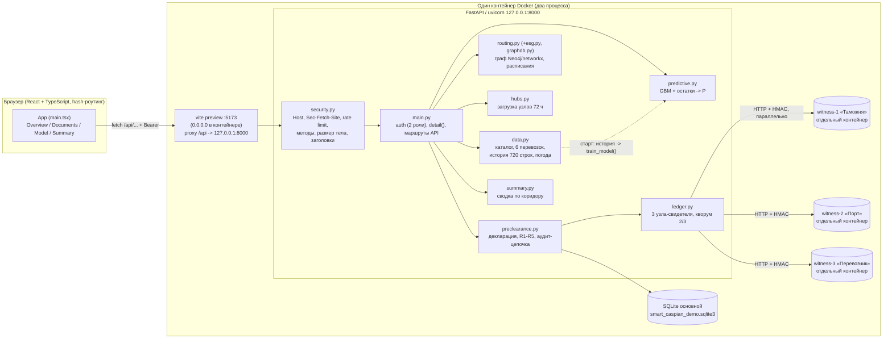
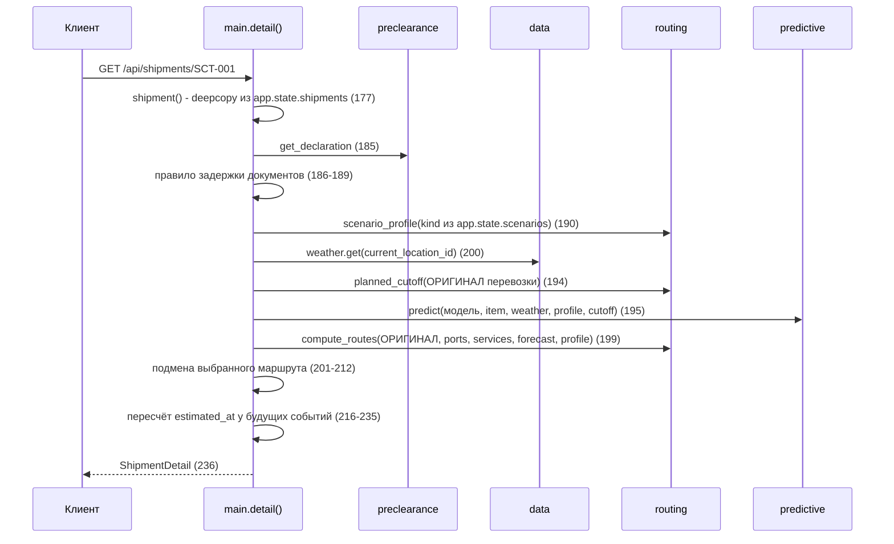
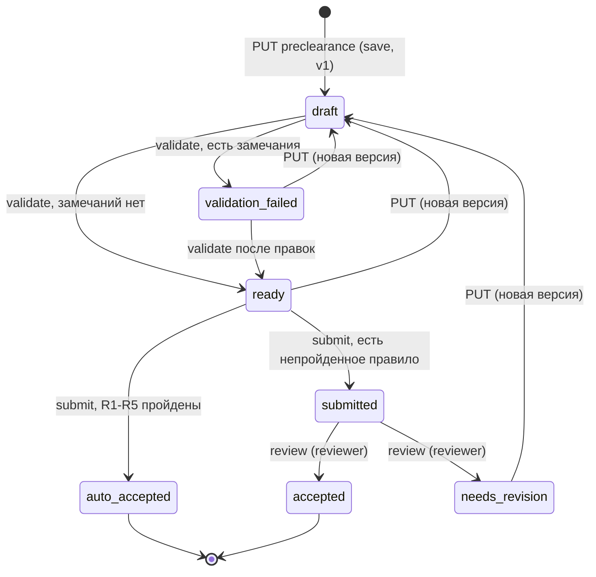

# Smart Caspian Transit — внутренний гид по устройству проекта

Назначение: каждый член команды должен уметь объяснить, **как именно** работает каждая функция,
и ответить на вопросы жюри. Все числа ниже измерены запуском кода в процессе (временная БД, часы
симуляции 2026-11-12T08:00:00Z, seed 42) на коммите этой ветки; формулировки о коде проверены по
исходникам, а не по существующим документам. Где `docs/*.md` расходятся с кодом — это отмечено
в разделе 7. Все данные синтетические; это прототип, а не операционная система.

Обозначения: `файл:строка` — места в коде; «P» — вероятность пропуска; «ч» — часы.

Содержание: 1 Карта системы · 2 Один запрос `GET /api/shipments/{id}` · 3 Функции кейса (a–j) ·
4 Связи между модулями · 5 Как проверить · 6 Вопросы жюри · 7 Слабые места · 8 Глоссарий.

---

## 1. Карта системы



**Состояние живёт в трёх местах.** (1) SQLite: декларации, записи аудита, ключи идемпотентности
(`preclearance.init_db`, `preclearance.py:238`). (2) Три базы свидетелей: в Docker — у каждого
узла-сервиса в своём томе (`witness-N-data:/data/witness.sqlite3`); без `LEDGER_WITNESS_URLS` —
файлы рядом с БД (`<db>.witness-<id>.sqlite3`, `ledger.witness_path`). (3) Память процесса: `app.state.scenarios`
(сценарий на перевозку), `app.state.selected` (выбранный маршрут), обученная модель
(`main.py:112-117`). Сценарий и выбор маршрута **глобальны для всех клиентов** и теряются при
перезапуске; декларации и аудит сохраняются.

**Старт приложения** (`main.py:110-120`, lifespan): загрузка синтетического каталога и истории
(`data.load_demo_data`), обучение модели на истории (`predictive.train_model`, ~0,15 с на 720
строках), создание таблиц, создание файлов свидетелей. Никаких сетевых вызовов.

**Runtime и почему так.** Docker-образ: один контейнер, два процесса (`scripts/docker-entrypoint.sh`):
uvicorn на `127.0.0.1:8000` внутри контейнера и `vite preview` на `0.0.0.0:5173`, который
проксирует `/api` на loopback (`frontend/vite.config.ts`, прокси без `changeOrigin`/`xfwd`, чтобы
API видел loopback-Host и не получал заголовков `X-Forwarded-*`). Наружу опубликован только UI, и
только на `127.0.0.1` хоста (`docker-compose.yml`). Причина: встроенные демо-токены
(`dev-broker-token`, `dev-reviewer-token`) принимаются **только от loopback-клиента без
заголовков проксирования** (`main.py:62-68`); в контейнере единственный такой клиент — наш прокси.
Контейнер работает от пользователя uid 10001, `read_only`, `cap_drop: ALL`, `no-new-privileges`,
`/tmp` в tmpfs, данные в томе `/data`; есть HEALTHCHECK на `/api/health`. Честное следствие:
безопасность демо-токенов держится на том, что порт 5173 опубликован только на loopback хоста;
открывать его наружу без смены токенов и `DISABLE_DEFAULT_TOKENS=1` нельзя.

Без Docker: `scripts/dev.sh` запускает uvicorn (`--no-proxy-headers`, чтобы подделанный
`X-Forwarded-For` не менял адрес клиента) и `vite dev` с тем же прокси.

---

## 2. Поток данных одного запроса: `GET /api/shipments/{id}`

Маршрут: `main.py:269` `get_detail` → под глобальным `RLock` вызывает `detail(shipment_id)`
(`main.py:183-237`). До этого запрос прошёл слои безопасности (раздел 3i) и зависимость `actor`
(токен любой роли, `main.py:148-168`). Ответ валидируется схемой `ShipmentDetail`
(`schemas.py`; `extra="forbid"` у всех контрактов).



Шаги по коду:

1. **`shipment(id)`** (`main.py:177`) — глубокая копия записи из `app.state.shipments`; 404 при
   неизвестном id. Копия нужна, потому что `detail()` меняет поля.
2. **Декларация и «правило задержки документов»** (`main.py:185-189`). Если декларация существует
   и её статус **не** из `{ready, submitted, auto_accepted, accepted}` (то есть `draft`,
   `validation_failed`, `needs_revision`), то `documents_ready_at = max(исходное, SIMULATION_NOW + 12 ч)`.
   Отсутствие декларации **не** задерживает документы. Смысл: пока документы не проверены, груз не
   может считаться готовым. Измерено для SCT-001: черновик → `documents_ready_at = 20:00Z`,
   P = 1,0, риск «высокий», пропущенная стыковка; после «Проверить» (`ready`) документы снова
   11:00Z и P = 0.
3. **Профиль сценария** `routing.scenario_profile(kind)` (`routing.py:10`) — словарь параметров
   (раздел 3c).
4. **Погода** `app.state.weather.get(current_location_id)` (`weather.py`, `WeatherService`) — при
   `WEATHER_PROVIDER=open-meteo` (по умолчанию) живые ветер на 10 м и осадки (Open-Meteo Forecast) и
   высота волны (Open-Meteo Marine) одним пакетным запросом на все узлы; кэш в памяти 30 мин; таймаут
   3 с (жёсткий предел 3,5 с). При сбое — последнее живое наблюдение (`source: cache`) или синтетическая
   таблица `data.get_weather` (`source: synthetic`, `fallback: true`), повтор через 2 мин. Для Оли
   (нет морской ячейки) волна — оценка по ветру (`wave_estimated: true`); внутренние узлы — 0 м.
   `observed_at` — время наблюдения Open-Meteo; `stale` — старше 3 ч по настоящим часам.
5. **Плановый cutoff** `routing.planned_cutoff(shipment(id), services, now)` (`routing.py:88`) —
   cutoff первого отправления **по исходному плану** (не по копии с задержанными документами).
   Нужен, чтобы вероятность пропуска и `missed_connection` относились к одному и тому же рейсу.
6. **Прогноз** `predictive.predict(...)` (`predictive.py:174`): дельта-задержка по GBM,
   `ready_at`, `miss_probability`, `risk`, факторы (раздел 3a). Принимает **копию с задержанными
   документами** и профиль (ветер/волна/очередь/опоздание).
7. **Маршруты** `routing.compute_routes(shipment(id) ← оригинал, ..., forecast, profile)`
   (`routing.py:101`): строится «плановый» маршрут и до 3 альтернатив от прогнозной готовности
   (раздел 3b). Комментарий `main.py:196-198`: исходный план документов намеренно сохраняется для
   базовой линии, иначе пропущенная стыковка пряталась бы.
8. **Выбранный маршрут** (`main.py:201-212`): если пользователь выбрал маршрут
   (`app.state.selected`) и он всё ещё допустим, он становится `current_route`, прежний плановый
   уходит в альтернативы; иначе выбор сбрасывается (маршрут мог стать недоступен после смены
   сценария).
9. **Оценки событий** (`main.py:216-235`): прибытие в порт =
   `planned_port_arrival + observed_delay + arrival_delay сценария`; события отправления
   (`sea_departure`/`rail_departure`/`road_departure`) берут `departure_at` соответствующего плеча
   текущего маршрута (по режиму и пункту), иначе `None`; `delivery` = `eta` маршрута. События с
   `actual_at` не трогаются. Помечаются `source="synthetic-model"`, `quality_flag="forecast"`.
10. **Ответ** `ShipmentDetail`: перевозка, погода, сценарий, прогноз, `current_route`,
   `alternatives`, `selected_route_id`, декларация.

Мини-сводка зависимостей: сценарий и документы → прогноз → готовность → маршруты → события.
`/api/dashboard` и `/api/summary` вызывают `detail()` для всех шести перевозок;
`/api/hubs/forecast` — тоже (раздел 3d). Время: дашборд ≈ 19 мс, прогноз узлов ≈ 17 мс.

---

## 3. Каждая функция кейса

### 3a. Предиктивная модель (`backend/app/predictive.py`, данные — `backend/app/data.py`)

**Как это работает.**

*Что предсказывает.* Одна регрессия: **дополнительная задержка в часах** (`delay_hours`) сверх уже
известных эффектов. Отдельного классификатора нет — вероятность пропуска считается из остатков
регрессии, поэтому она не может противоречить прогнозу задержки (`predictive.py:1-5`).

*Признаки* (`predictive.py:21-27`, порядок важен): `queue_hours`, `wind_mps`, `precipitation_mm`,
`observed_delay_hours`, `mass_tonnes`, `wave_height_m`. Монотонные ограничения
`(1,1,1,1,0,1)`: больше очереди, ветра, осадков, известной задержки или волны **никогда не
уменьшает** прогноз; масса свободна. Модель — `HistGradientBoostingRegressor` (квадратичная
потеря, `min_samples_leaf=10`, без early stopping, `random_state=seed`); при менее чем 20 строках
обучения — `DummyRegressor` со средним (`predictive.py:74-80`). Прогноз обрезается снизу нулём
(`_delays`, `:83`). `hours_to_cutoff` **не признак**: он нужен только чтобы разметить пропуски в
отложенной выборке (`:28-29`).

*Волна.* История содержит `wave_height_m`; если нет — оценка из ветра
`min(8, 0,2 + 0,009·ветер²)` м (`data.py:689`). В `predict`: берётся волна сценария (шторм = 4,5 м),
иначе наблюдаемая у порта; если ветер переопределён сценарием без волны, то волна пересчитывается
из этого ветра (`predictive.py:197-202`).

*Откуда история.* `data._build_history` (`data.py:749`): 720 независимых строк за 90 дней
до SIMULATION_NOW (8 строк в сутки), seed 42. Режимы: шторм 13 % (ветер 18–30), «очередь» 9 %,
«ветреный» 10 %, нормальный — остальные. Задержка — нелинейная формула `_delay_hours`
(`data.py:702-746`): база `0,2 + 0,055·очередь + 0,0025·масса + 0,10·известная_задержка`; погода
`0,035·max(0, ветер−9)^1,8 + 0,06·осадки^1,35 + 0,45·max(0, волна−1,7)^1,5`; взаимодействие ветер×очередь;
штраф за очередь выше 4 ч; бонус шторма `5 + 0,12·max(0, ветер−18)^1,2`; **гетероскедастичный** гауссов
шум σ = 0,25 + 0,035·ветер + 0,06·очередь (×1,5 в шторм).

*Ненаблюдаемые факторы* (не колонки истории и не признаки модели — ровно то, чего модель знать не может):
поломка крана с вероятностью 4 % + 1 п.п. на час очереди (+2–9 ч); выборочный досмотр 12 %
(гамма(2; 0,9), в среднем +1,8 ч, длинный хвост); разброс смены σ 0,4 ч (`_unobserved_delay_hours`).
*Запас до cutoff* — как у реального планировщика: бронь делается заранее по «хорошей погоде»
(бесшумная формула при ветре ≤ 10 м/с, без осадков и шторма) плюс буфер (шторм −1…5 ч, очередь
−0,5…6, ветрено 0…8, норма 0…10). *Метка* сравнивает с **фактическим** cutoff, который сдвигается:
σ 2 ч, 8 % — судно задержано (+2–8 ч), 5 % — приём закрыт раньше (−1…3 ч) (`_departure_slip_hours`).
Итого: 242 пропуска из 720 (33,6 %); в тесте 55 из 144.

*Разделение train/test* (`train_model`, `:101-171`): история сортируется по времени, **первые 80 %**
(576 строк) — обучение, последние 20 % (144 строки, граница `2026-10-25T10:10:51Z`) — тест; без
перемешивания, тест не участвует ни в обучении, ни в baseline, ни в остатках. Baseline — медиана
задержки обучающей части (константа).

*Как считается вероятность пропуска.* (1) **Остатки**: последняя четверть обучающих строк (144)
оценивается вспомогательной моделью, обученной на предыдущих строках, `остаток = факт − прогноз`
(`:146-152`, не in-sample-оптимистичны). Измеренные остатки: среднее +0,27 ч, σ = 2,18 ч,
5-й/95-й перцентили −2,43/+4,79 ч (правый хвост — поломки кранов и досмотры). (2) В `predict` считается `known_ready = прибытие + известная
задержка + опоздание сценария + очередь + доп. очередь + 1 ч обработки` (`:211`), `бюджет = cutoff −
known_ready` в часах (`:228`). (3) `P = доля остатков r, для которых max(0, delay + r) > бюджет`
(`_miss_probabilities`, `:90-98`; равенство считается «вовремя»). Если `documents_ready_at` позже
cutoff, `P = 1.0` без вероятностей (`:225-226`). Гранулярность P = 1/144 ≈ 0,007.

*Готовность:* `ready_at = max(known_ready + delay_hours, documents_ready_at)` (`:221-224`).

*Пороги риска* (`:256`): `P < 0,35` — low; `P < 0,7` — medium; иначе high. Для маршрута и дашборда
действует собственное правило: «под риском» = `risk == high` **или** маршрут недопустим
(`main.py:258`).

*Факторы* (`:232-251`) — детерминированные пояснения входных условий, **не SHAP и не причинная
атрибуция**: ветер ≥ 15 «High», ≥ 8 «Moderate», иначе «Low»; очередь ≥ 3 ч «Long»; волна ≥ 3 м «High
sea state», ≥ 1,5 «Moderate»; осадки; «известная задержка учтена один раз»; «документы определяют
готовность»; «готовность после cutoff»; плюс оговорка о некалиброванности.

*Метрики* (`GET /api/model/metrics`): MAE модели 1,513 ч против 5,019 ч у baseline на 144
отложенных строках; ROC AUC = 0,899; версия `gbm-v4`.

**Почему ROC AUC = 0,90, а не 1,0.** В прежней версии генератора метка «пропуск» была
детерминированной функцией признаков (запас известен на входе), и AUC = 1,0 ничего не доказывал.
Теперь в истории есть ненаблюдаемые инциденты и сдвиг фактического cutoff, поэтому потолок ниже 1:
даже «оракул», знающий фактическую задержку строки, получает на тесте AUC ≈ 0,94; ранжирование
только по запасу — 0,85, только по прогнозу задержки — 0,83; модель (прогноз + запас + разброс
остатков) — 0,90. На других seed AUC 0,83–0,93, т. е. 0,90 — не подобранное значение. MAE 1,51 ч против
5,02 ч у baseline: модель заметно лучше константы, но ошибка в полтора часа честно отражает
непредсказуемые поломки и досмотры. Всё это — синтетика той же формулы, на которой модель обучалась;
это демонстрация методики оценки на отложенной выборке, а не точность на реальных рейсах.
Переобучения нет: разделение хронологическое, тест не участвует ни в обучении, ни в остатках.

*Измеренный отклик модели* (база: очередь 1, ветер 6, осадки 0, известная 0, масса 20, волна 0,5):
база 1,65 ч (включает средний вклад ненаблюдаемых инцидентов); ветер 22 м/с при волне 0,5 — 9,3 ч;
волна 4,5 м при ветре 6 — 8,8 ч; ветер 22 + волна 4,5 — 17,6 ч; очередь 7 ч — 1,9 ч. Шторм по сценарию
(ветер 22, волна 4,5, очередь +2, опоздание +3) даёт 17,7 ч. **Коллинеарность:** корреляция ветер/волна в истории 0,94 (ветер²/волна 0,98), так как
волна генерируется из ветра ×(0,7…1,3); поэтому вклад волны модель отделить от ветра не может — это
известное ограничение, а «волна как признак» в первую очередь — понятное жюри объяснение шторма.

**Где в коде.** `predictive.py`: признаки `:21-27`, `_fit :74`, `_miss_probabilities :90`,
`train_model :101`, `predict :174`, пороги `:256`. `data.py`: волна `:689`, формула `:702`,
история `:749`, погода `:860-895`. `main.py:112-114`, `:195`. `GET /api/model/metrics` — `main.py:247`.
UI: страница «Модель» (`main.tsx`, `metrics`), карточка «Анализ риска задержки»
(`overview/Overview.tsx:656`).

**Как показать в демо.** `#/overview/SCT-001` → «Шторм»: риск «Высокий», P = 100 %, фактор
«Сильное волнение», готовность 13 ноя ≈ 10:10Z вместо 12 ноя ≈ 12:40Z; `#/model`: MAE, baseline и
AUC 0,90 (см. вопросы 8–9). Строка источника внизу показывает «Погода: Open-Meteo, <время> UTC».

**Ограничения.** Данные и мишень синтетические; нет сезонности и портов; нет калибровки (P — доля
остатков, не откалиброванная вероятность); факторы — объяснения входов; модель обучена один раз на
старте; один «хаб» не моделируется отдельно; `observed_delay_hours` из каталога — число, а не поток
AIS/событий.

---

### 3b. Маршрутизация и альтернативы (`backend/app/routing.py`)

**Как это работает.**

*Граф и расписания* (`data.py:174-336`). Узлы: 8 портов/терминалов; 11 сервисов-рёбер, каждый со
списком `departures` (UTC), `cutoff_hours` (приём груза закрывается за N ч до отправления),
`handling_hours` (перегрузка при пересадке), `duration_hours`, `capacity_tonnes`, `cost_usd`,
`allowed_cargo`, `distance_km`. Западная линия: `rail-main` (Астрахань→Махачкала, ежедневно 06:00Z),
`sea-main` (Махачкала→Энзели, 18:00Z, cutoff 4 ч), `transfer-olya` (Махачкала→Оля, автомобиль,
**каждый час**, cutoff 0,5 ч), `sea-olya` (Оля→Энзели, 22:00Z), `road-final` (Энзели→Тегеран, каждые
6 ч). Восточная: `rail-east`, `sea-aktau`, `rail-kz-tm`, `sea-tkm`, `sea-mak-amirabad`,
`rail-amirabad`.

*Плановый путь* `_planned_path` (`:68`): остаток `planned_service_ids`, начиная с первого
сервиса, чей `origin_id` = текущий пункт. Например, для SCT-001 в Махачкале это `sea-main + road-final`.

*Планирование плеч* `_schedule` (`:35-52`): для каждого сервиса пути проверяется — не заблокирован,
вместимость ≥ масса, груз разрешён; затем берётся **первое отправление `d ≥ now`**, для которого
`доступность ≤ d − cutoff_hours`, где доступность = готовность + `handling_hours` (для первого плеча
обработка 0, она уже учтена в готовности); прибытие = `d + duration`, оно же готовность для
следующего плеча. Любое нарушение → `None` (маршрута нет).

*Три прогона для плана* (`compute_routes :101-146`):
`baseline` — по **плановой** готовности (`прибытие + очередь + 1 ч` или документы, что позже,
`_planned_ready :82`) без сценария; `actual` — по **прогнозной** готовности `ready_at` с блокировками
сценария; `unblocked` — то же, но без блокировок.

*Определение `missed_connection`* (`:116-118`): `baseline` существует И (`unblocked` не нашёлся ИЛИ
**хотя бы у одного плеча `departure_at` отличается от baseline**). Следствия: (1) любой сдвиг
отправления, даже на следующий часовой слот, считается «пропущенной стыковкой»; (2) закрытие линии
само по себе не `missed` (используется `unblocked`), но делает `actual = None`.
Текущий маршрут: если `actual is None` → `feasible=False`, пустой `legs`, `id="unavailable:…"`,
причина «недоступен в текущих условиях»; иначе `feasible = not missed`, причина «стыковка пропущена;
показан ближайший вариант» (`:119-126`). То есть «недопустимый» маршрут при `missed` всё равно имеет
плечи — ближайшее восстановление.

*Альтернативы*: если `missed` — первой идёт «Next-departure recovery» (те же сервисы на следующих
слотах). Затем все цепочки сервисов по **простым путям** origin → destination — их отдаёт
топологический бэкенд (`graphdb.py`, см. 3b′): Cypher-запрос к Neo4j или резервный
`nx.all_simple_paths` + `itertools.product` по параллельным сервисам. Каждый кандидат планируется
от `ready` с блокировками.
Кандидат с `id`, совпадающим с текущим, отбрасывается, пока текущий допустим. **Ранжирование:**
`sorted(key=(eta, cost_usd, id))[:3]` — раньше ETA, затем дешевле, затем id для стабильности; не
более **трёх**. `id` маршрута = `сервис@отправление+...` — по нему UI выбирает маршрут.

*Выбор маршрута* — `POST /api/shipments/{id}/route` (`main.py:288`): повторно вычисляется `detail()`,
маршрут должен быть допустим, иначе 409; результат в `app.state.selected`. Это **симуляция выбора, не бронирование**.

*Цена и CO₂е* на каждом плече: `cost_usd` сервиса (без зависимости от массы), CO₂е — раздел 3g.

Примеры (база): SCT-001 — `sea-main@12 ноя 18:00 + road-final@14 ноя 00:00`, ETA 14 ноя 06:00,
$1 600, 942 кг; альтернативы: через Олю (ETA 13 ноя 18:00, $1 800, 1 613 кг — **быстрее, но дороже и
грязнее**) и через Амирабад (ETA 15 ноя 10:00, $2 200, 445 кг). При закрытии `sea-main` текущий
маршрут недоступен, а те же две альтернативы остаются допустимыми.

**Где в коде.** `routing.py`: профиль `:10`, `_schedule :35`, `_route :55`, `_planned_path :68`,
`planned_cutoff :88`, `compute_routes :101`, `missed :116`, альтернативы `:128-146`. Выбор —
`main.py:201-212, 288-296`. UI: `overview/RouteMap.tsx`, `LegGantt.tsx`, карточка «Альтернативные
маршруты» (`Overview.tsx:782`).

**Как показать в демо.** SCT-001 → «Закрытие»: «Плановый маршрут недоступен», на карте альтернативы
через Олю/Амирабад → «Выбрать» → маршрут, события, CO₂е и прогноз узлов обновились (Махачкала
перестаёт получать груз). Показать «быстрее — не значит экологичнее».

**Ограничения.** Расписание и цены синтетические и статичные; вместимость не «расходуется» (нет
конкуренции за места); нет временных окон причалов; один вид груза; граф маленький (простые пути
перебираются полностью — на сотнях узлов потребуется k-кратчайшие пути/ILP); `missed_connection`
зависит от плановой базовой линии и считает любое изменение слота (см. раздел 7); блокировка —
только по `service_id`.

### 3b′. Графовая БД коридора (`backend/app/graphdb.py`, Neo4j)

**Зачем графовая БД.** Коридор — граф: хабы и расписанные сервисы между ними; ключевой вопрос
маршрутизации — «какие цепочки сервисов соединяют A и B, минуя закрытые» — это обход графа, который
в Cypher записывается одним шаблоном пути, а не циклом с JOIN-ами. В стеке кейса прямо названы
графовые БД. Neo4j хранит только **топологию**; расписание, cutoff, вместимость и груз проверяет
Python (`routing._schedule`) — так поведение не зависит от бэкенда.

**Модель данных.** `(:Hub {id, name, country, lat, lon, kind})` и связи
`[:SERVICE {id, mode, distance_km, duration_hours, departures[], cutoff_hours, handling_hours,
capacity_tonnes, cost_usd, allowed_cargo[]}]`. Почему связь, а не узел `:Service`: у сервиса ровно
одна пара (откуда, куда), расписание — плоский список строк (Neo4j хранит списки примитивов),
параллельные сервисы (например, два рейса Махачкала→Энзели) — параллельные связи, и путь из
`:SERVICE` *и есть* цепочка сервисов — не нужен перебор `product` по рёбрам. Узел `:Service`
понадобился бы, если бы у рейса были промежуточные заходы или отдельные слоты-узлы.

**Загрузка.** При старте API (`graphdb.connect` в `lifespan`): ограничение уникальности `Hub.id`,
индекс по `SERVICE.id`, затем в одной транзакции `MERGE` хабов, удаление связей, которых нет в
каталоге или у которых сменились концы, `MERGE` сервисов. Повторный старт ничего не дублирует
(проверяется тестом).

**Запрос.**

```cypher
MATCH p = (o:Hub {id: $origin})-[:SERVICE*1..8]->(d:Hub {id: $destination})
WHERE none(r IN relationships(p) WHERE r.id IN $blocked)
  AND all(i IN range(0, size(nodes(p)) - 2) WHERE NOT nodes(p)[i] IN nodes(p)[i + 1..])
RETURN [r IN relationships(p) | r.id] AS service_ids
```

Cypher сам запрещает повтор связи в пути; второй предикат запрещает повтор узла (простой путь, как
`nx.all_simple_paths`). `$blocked` — `scenario.blocked_service_ids` (при «Закрытии» — `sea-main`).
Предел 8 плеч — защита от взрыва перебора; в каталоге 8 узлов, простой путь ≤ 7 плеч, так что
предел ничего не отсекает (та же отсечка `cutoff=8` стоит и в networkx). Пример: Махачкала → Тегеран
при закрытии → `[transfer-olya, sea-olya, road-final]`, `[sea-mak-amirabad, rail-amirabad]`.

**Резерв.** `GRAPH_DB_URL` не задан → `networkx` (лог «GRAPH_DB_URL not set»). Задан, но недоступен
при старте (5 попыток по 2 с) → `networkx` + предупреждение «Neo4j unreachable at startup». Ошибка
запроса во время работы → ответ через `networkx` (один WARNING), `/api/health` показывает
`networkx`; когда Neo4j снова отвечает — обратно `neo4j`. Пароль и URL в лог не пишутся.
`/api/health` → `graph_backend`; в UI — строка источников под карточкой перевозки
(«граф маршрутов: Neo4j (Cypher)»).

**Паритет.** `tests/test_graphdb.py`: (1) networkx-бэкенд равен прежнему перебору из `routing.py`
для всех пар узлов; (2) при `GRAPH_DB_TEST_URL` — множества цепочек Neo4j = networkx для всех 64 пар
узлов × 13 вариантов блокировки; (3) сквозной прогон API: каждый вызов `compute_routes` для всех
6 перевозок × 4 сценариев считается обоими бэкендами, результаты должны совпасть полностью
(текущий маршрут, альтернативы, их порядок).

**Docker.** Сервис `graph` (`neo4j:5.26.10-community`): heap 512 МБ, page cache 128 МБ,
`mem_limit` 1280 МБ, том `caspian-graph`, порты не публикуются, healthcheck по HTTP 7474;
`app` стартует после `service_healthy`.

---

### 3c. Сценарии (`routing.scenario_profile`, `routing.py:10-21`)

Сценарий задаётся **на перевозку** (`POST /api/shipments/{id}/scenario`, `main.py:274`), хранится в
`app.state.scenarios`, сбрасывается выбор маршрута. Параметры:

| kind | `arrival_delay_hours` | `queue_extra_hours` | `wind_mps` | `wave_height_m` | `blocked_service_ids` |
|---|---|---|---|---|---|
| `none` | 0 | 0 | — (из погоды порта) | — | — |
| `storm` | 3 | 2 | 22 | 4,5 | — |
| `congestion` | 0 | 6 | — | — | — |
| `closure` | 0 | 0 | — | — | `["sea-main"]` |

Где действует каждое поле:

* `arrival_delay_hours` → вход модели (`observed + arrival_extra` как признак «известная задержка») и
  `known_ready` (`predictive.py:211, 218`); оценка `port_arrival` у события (`main.py:217`); сдвиг фоновых
  прибытий в прогнозе узлов (`hubs.py:231`).
* `queue_extra_hours` → признак `queue_hours` и `known_ready` (`predictive.py:218`), фактор
  «Scenario queue extension included once»; ожидание и (для congestion) спрос в прогнозе узлов.
* `wind_mps`/`wave_height_m` → признаки модели (`predictive.py:195-202`); в прогнозе узлов `wind`
  определяет, что сценарий — шторм, и величину падения пропускной способности.
* `blocked_service_ids` → `_schedule(..., blocked)` в `compute_routes` (маршрут недоступен) и в
  `hubs._regional_effects` (потеря береговой/морской мощности).

Эффекты, измеренные на SCT-001 (остальные в базе): шторм — задержка 17,7 ч, P = 100 %, готовность
13 ноя ≈ 10:10Z, пропущенная стыковка, «под риском» 4 из 6; очередь — задержка 1,92 ч, P = 100 %
(нулевой запас → слот 13 ноя), 4 из 6; закрытие — прогноз прежний, маршрут недоступен, CO₂е парка
5 570 → 4 628 кг (маршрут без плеч в сумму не входит).
**Нюанс интерпретации:** при `congestion` у SCT-001 P = 100 %, потому что известная готовность
(10:00 прибытие + 0,5 + 6 ч доп. очереди + 1 ч обработки = 17:30Z) уже позже cutoff рейса
`sea-main` (14:00Z): бюджет отрицателен, и никакой остаток его не спасает. Общая логика везде одна:
бюджет = cutoff − `known_ready`; P — доля остатков, превышающих бюджет.

**Как показать.** Кнопки «Шторм / Очередь / Закрытие / Базовый» слева; счётчик «Перевозки под
риском» меняется. Сценарий действует на **одну выбранную перевозку** (шторм «в Махачкале» для
SCT-001–003, 005; «в Актау» для SCT-004, 006).

**Ограничения.** Сценарии — пресеты, а не потоки событий; не комбинируются; «шторм» — локальный (порт
текущего пункта), а не «во всём Каспии».

---

### 3d. Прогноз загрузки хаба на 72 часа (`backend/app/hubs.py`)

`GET /api/hubs/forecast?shipment_id=…` (`main.py:352`) собирает `detail()` для всех шести перевозок
(в каждой уже учтён её сценарий и выбранный маршрут), строит «региональный» профиль из сценария
запрошенной перевозки и вызывает `hubs.forecast` (`hubs.py:309`).

**Спрос на узле = фон + перевозки (+ переток).**

* *Фон* — детерминированная синтетика: `background_profile(port_id, now)` (`:126`) даёт 73 множителя
  (часы 0…72) вокруг 1: суточный косинус (пик 10–16 UTC, амплитуда 0,24–0,34), вторая гармоника
  0,04–0,10, уровень 0,96–1,04, шум ±0,04 — всё из `Random("hubs:42:<port>")` (строковый seed →
  одинаков во всех процессах). Фон т/ч = `capacity_tph × base_utilization × профиль` (`:334-336`).
* *Параметры узлов* `NODE_PARAMS` (`:64-73`, т/ч и средняя загрузка): rail_hub 70/0,50, makhachkala 76/0,46,
  olya 46/0,42, anzali 76/0,45, tehran 60/0,46, aktau 60/0,48, turkmenbashi 48/0,50, amirabad 40/0,50;
  для неизвестных id — по виду узла (`KIND_DEFAULTS`). Это «демо-масштаб»: подобраны так, чтобы
  один груз в 20 т был виден на кривой.
* *Перевозки* `_visits` (`:147`): по `current_route` каждого груза — посещение каждого узла маршрута:
  прибытие/отправление; если маршрута нет — груз «держится» в текущем узле до конца горизонта.
  `_visit_demand` (`:187`): выгрузка в окне 4 ч после прибытия и погрузка 4 ч до отправления
  (`HANDLING_WINDOW_HOURS`), плюс «двор» — 3 % массы в час на всём времени пребывания
  (`YARD_SHARE_PER_HOUR`); на последнем узле выгрузка 3 ч.

**Очередь и загрузка** (`:348-361`, жидкостная модель): `backlog` переносится вперёд;
`utilization = min(2,5, (спрос + backlog_prev/4) / capacity)`; `backlog = max(0, backlog_prev + спрос − capacity)`;
`ожидание = backlog/capacity + 0,15·ρ²/(1−ρ) + сценарное_ожидание` (ρ ограничено 0,95; максимум 72 ч).
Часовые точки: `at, utilization, load_tph, capacity_tph, background_tph, shipments_tph, queue_hours, shipment_ids`.

**Региональный сценарий** (`_regional_effects :214`). Узел выбора = текущий пункт запрошенной
перевозки (Махачкала для 001–003/005, Актау для 004/006), иначе `makhachkala`.
* *Шторм* (`wind` не `None`): потеря мощности `min(0,6, (ветер−10)/30)` = 0,4 при 22 м/с; полная
  сила 18 ч, затем линейный спад 6 ч (`STORM_HOURS`, `STORM_RECOVERY_HOURS`); ожидание +`queue_extra`;
  фон сдвигается на `arrival_delay` (3 ч).
* *Очередь* (`queue_extra>0` без ветра): спрос ×(1 + 0,06·6) = ×1,36, полностью 30 ч, спад 24 ч; ожидание +6 ч.
* *Закрытие* (`blocked_service_ids`): у **начала** закрытого сервиса мощность ×0,5 (берег работает,
  причал нет), спрос ×0,7; пункт назначения закрытого сервиса получает ×0,85; 30 % фонового потока
  делится поровну между оставшимися соседями из того же узла (для sea-main: Оля и Амирабад).

**Окна узких мест** (`_windows :269`): час «горячий» при `utilization ≥ 0,85`
(`BOTTLENECK_THRESHOLD`); подряд идущие горячие часы с разрывом ≤ 2 ч (`MERGE_GAP_HOURS`)
**сливаются** в одно окно; у окна — пик, макс. ожидание, `severity = high` при пике ≥ 1,0 иначе `medium`,
причины (шторм/очередь/закрытие/переток/«перевозки обрабатываются»/«груз задержан»/фон), список
затронутых перевозок. Статус узла: `bottleneck` при пике ≥ 0,85, `busy` ≥ 0,7, иначе `ok`.

**Измерено** (шесть перевозок, сценарий только у SCT-001): база — одно окно в Махачкале 12 ноя
16–18Z, пик 92 %; шторм — окно 12 ноя 12:00Z–13 ноя 03:00Z, пик 165 % (мощность 76 → 45,6 т/ч),
severity high; очередь — два окна, пик 110 %; закрытие — Махачкала 148 % (мощность 38 т/ч), переток на
Олю ≈ 96 % и Амирабад ≈ 99 %.

**Чем это отличается от «простого правила».** Не пороговое «если груза > N, то узкое место», а
динамика: накопление очереди во времени (backlog переносится), суточный фон, мощность, меняющаяся
со сценарием и во времени, реальные визиты грузов по маршрутам (выбор альтернативы переносит нагрузку
на другие узлы) и перетоки при закрытии. Но параметры — демо-значения, а не калиброванные
по статистике портов.

**Где в коде.** `hubs.py`: параметры `:53-103`, `background_profile :126`, `_visits :147`,
`_regional_effects :214`, `_windows :269`, `forecast :309`. UI: `overview/HubPanel.tsx` (ползунок
«Горизонт прогноза», `HUB_STEP = 3`, `useHubForecast :44`), слой «Загрузка узлов» на карте.

**Как показать.** «Шторм» → слой «Загрузка узлов» → двигать ползунок / ▶: кольцо Махачкалы краснеет,
карточка «Узкие места · 72 ч»; «Закрытие» → переток на Олю/Амирабад → «Выбрать» альтернативу → окна
меняются.

**Ограничения.** Фон — синтетика; нет границ причалов/кранов, пересменок; пропускная способность
одна цифра на узел; на прогноз влияют только 6 демо-перевозок; прогноз не использует модель из 3a.

---

### 3e. Жизненный цикл pre-clearance («смарт-контракт», `backend/app/preclearance.py`)



(`validate` из `ready` допустим повторно; из `submitted`, `auto_accepted`, `accepted`,
`needs_revision` — нет, `ValueError("Save a draft before validating")`, `:445-446`. `PUT` из
`submitted` запрещён, `:318-319`; из `auto_accepted`/`accepted` — разрешён и создаёт новую версию.)

**Операции** (все меняют состояние под `BEGIN IMMEDIATE`, добавляют **одну** запись в аудит-цепочку и
после коммита предлагают её свидетелям; сбой свидетелей не откатывает запись, `:296-299`):

* `save` `PUT` (`:307`): роль broker; размер полезной нагрузки ≤ 64 КиБ; версия +1 (≤ 500); статус
  `draft`; `content_hash = SHA-256(канонический JSON payload)`.
* `validate` `POST` (`:440`): роль broker; проверки `_validate` (`:332`): обязательные поля не пустые;
  `origin_country` — две латинские буквы; `hs_code` — 6–10 цифр; в `documents` ровно по одному
  `invoice`, `packing_list`, `transport`; `container_id` декларации и **каждого документа** равен
  контейнеру перевозки; **все массы** (декларации, перевозки, документов) отличаются не более чем на 1 кг.
  Результат → `ready` либо `validation_failed`.
* `submit` `POST` (`:473`): роль broker; заголовок `Idempotency-Key`; требует `ready`; запускает
  `evaluate_ruleset` → `clearance` (решение, результаты правил, `ruleset_hash`), записывается в запись
  аудита `submit`. Все пять правил пройдены → `auto_accepted`; иначе `submitted` (ручная проверка).
* `review` `POST` (`:508`): роль reviewer; допустимо только из `submitted`; решение
  `accepted` или `needs_revision`; комментарий ≤ 1000 символов попадает в аудит.

**Набор правил `rules-v1`** (`:366-410`; значения иллюстративные, не таможенные списки):

| Правило | Что проверяет | Параметры |
|---|---|---|
| R1 | документы согласованы с декларацией (повторяет `_validate`: контейнеры, массы) | допуск массы 1 кг |
| R2 | HS-код **не** начинается с префиксов ручного контроля | `93`, `2844`, `3601`, `3602`, `3603`, `3604` |
| R3 | `value_usd / mass_kg` в диапазоне | 0,05 … 500 $/кг |
| R4 | отправитель в списке «доверенных» (имитация AEO) | `ООО «Волга Экспорт» / ТОО «Степь Экспорт» / Persian Caspian Export` |
| R5 | страна происхождения в списке | `RU, KZ, IR, AZ, TM, UZ` |

`ruleset_hash` = SHA-256 канонического JSON определения (id и список правил с параметрами;
`:413-424`) = `fcb5698e…428d48` (измерено). Он попадает в каждое решение и в запись аудита, поэтому
позднее изменение списков/порогов видно как другой хеш. Это защита от «тихой подмены правил»,
а не доказательство юридической силы. Определение отдаётся `GET /api/preclearance/ruleset`.

**Ключ идемпотентности** (`submit`, `:473-505`; таблица `submission_keys`, ключ
`(actor_id, shipment_id, key)`): повтор с тем же ключом **возвращает исходный ответ** без новой записи в
аудите (проверка предшествует проверке статуса — повтор работает и после последующего review);
если с тех пор у декларации другая версия/хеш → 409 «Idempotency key conflicts with revised
declaration»; повторная «новая» отправка принятой декларации с другим ключом → 409 «Declaration must be
ready». Ключ — `[A-Za-z0-9._:~-]{1,128}`. UI генерирует случайный ключ на логическую отправку
(`shipment|версия|content_hash`) и переиспользует его при повторе (`main.tsx:840-846`).

**Роли.** `broker`: сценарии, выбор маршрута, save/validate/submit; `reviewer`: только review (брокер
получает 403 — «broker cannot decide its own declaration»); чтение — любым из двух токенов.

**Эффект на остальной продукт:** статус декларации влияет на готовность груза (правило 12 ч, раздел
2) и на статус в сводке `docs_pending` (`summary.py:83-91`).

**Где в коде.** `preclearance.py` как выше; API `main.py:298-345`; UI `main.tsx` (страница «Документы»,
`ClearanceStepper :1240`, `ClearanceCard :1275`, кнопки `:800-870`).

**Как показать.** SCT-001: «Сохранить» → «Проверить» → «Отправить» → «Одобрена автоматически» и
карточка R1–R5 с хешем; затем сменить отправителя на недоверенного → R4 ✗ → «На рассмотрении» →
роль проверяющего → «Принять» (или «На доработку»). Затем вернуться на «Обзор»: готовность груза
изменилась (черновик → риск «Высокий»).

**Ограничения.** Это не таможенная система и не интеграция с ФТС/ЕАЭС; «смарт-контракт» — детерминированный
набор правил в Python, не исполняемый в блокчейне; списки/пороги придуманы; нет электронной подписи
документов, нет загрузки сканов; роли — два общих токена.

---

### 3f. Хеш-цепочка аудита и реестр свидетелей

**Хеш-цепочка** (`preclearance.py:275-293`). Каждое действие (`save/validate/submit/review`)
добавляет запись `{sequence, declaration_id, action, actor, at, payload, previous_hash, hash}`;
`payload` содержит `version, status, content_hash` + специфику (замечания / решение правил / решение и
комментарий проверяющего). `hash` — дайджест канонического JSON записи **без поля `hash`**
(`sort_keys`, компактные разделители, UTF-8). Первая запись ссылается на `previous_hash = 64 нуля`.

*Режимы:* без `AUDIT_HMAC_KEY` — обычный SHA-256 (ловит порчу и наивные правки; тот, кто может
писать в SQLite, может пересчитать всю цепочку); с ключом ≥ 16 символов — HMAC-SHA256: без ключа
нельзя подделать/переставить/продлить цепочку, но проверяющий и «писатель» обладают одним и тем же
симметричным ключом. Включение/смена ключа делает прежние цепочки недействительными — начинать с
новой БД (`:10-26`).

*Проверка* `verify_audit` (`:552-605`): читает декларацию и записи в одном снимке; для каждой записи:
строгий разбор (ровно ожидаемые поля, `hash`/`previous_hash` — 64 hex, без дублей ключей),
каноничность (`_json(entry) == строка в БД`), номер = порядковый, `previous_hash` совпадает с хешем
предыдущей, пересчитанный дайджест совпадает, `declaration_id` верный. Затем **декларация должна
соответствовать последней записи** (content_hash, версия, статус, время, validation, clearance;
`_declaration_matches :538`). Далее сравнение с реестром (ниже). Ответ: `valid`, `entries_checked`,
`first_invalid_sequence`, блок `ledger`. Измерено: правка записи 2 с пересчётом собственного хеша —
цепочка рвётся на 3-й записи; **полная перепись всей цепочки с пересчётом** (без ключа) — `valid=False`,
`first_invalid=2`, `ledger.reason=hash_mismatch` (ловит реестр); с `AUDIT_HMAC_KEY` пересчёт обычным
SHA-256 ломается на первой записи.

**Реестр свидетелей** (`ledger.py` + `witness_node.py`, прототип permissioned-леджера). Три узла:
`witness-1` «Таможня», `witness-2` «Порт», `witness-3` «Перевозчик»; у каждого своя SQLite (права 0600)
и свой ключ HMAC-SHA256 (по умолчанию детерминированные **публичные** dev-ключи
`dev-witness-key/<node>/NOT-A-SECRET`; замена — `LEDGER_WITNESS_KEYS`, каждый ≥ 16 символов).

*Два транспорта, один протокол.*
* **Сетевой режим** (`LEDGER_WITNESS_URLS` задан — так в `docker-compose.yml`): каждый узел — отдельный
  процесс `python -m backend.app.witness_node` (FastAPI + uvicorn) в своём контейнере, со своим томом,
  в внутренней сети `ledger` (`internal: true`, порты на хост не публикуются, выхода в интернет нет),
  `read_only`, `tmpfs`, `cap_drop: ALL`, `no-new-privileges`, healthcheck `GET /health`.
  Эндпоинты узла: `POST /attest` (append-only запись; 409 при конфликте с его цепочкой),
  `GET /records/{id}`, `GET /head/{id}`, `GET /health` (без данных). API ходит к трём узлам
  **параллельно** (пул потоков, таймаут `LEDGER_WITNESS_TIMEOUT`, по умолчанию 1,5 с; общий дедлайн),
  без прокси и редиректов.
* **Режим в процессе** (переменная не задана — тесты, `dev.sh`): те же три узла внутри API,
  файлы `<db>.witness-<id>.sqlite3` рядом с БД. Логика добавления/проверки общая (`append_record`,
  `_verify_rows`).

*Аутентификация (сеть).* Запрос к узлу несёт `X-Witness-Timestamp`, `X-Witness-Nonce` и
`X-Witness-Auth` = HMAC(ключ, производный от ключа узла; метод, сырой путь, время, nonce, SHA-256 тела).
Узел отказывает (401) без подписи, с чужим ключом, с изменённым телом, вне окна ±120 с и при повторе
nonce — **неаутентифицированная запись невозможна**. Ответ узла несёт `X-Witness-Reply-Auth` —
HMAC над nonce запроса, HTTP-статусом и телом: подменённый или переигранный ответ API отбрасывает
(узел показывается как «расхождение», `error = bad_reply`), а подпись записи в `/attest` проверяется
ещё раз по ключу узла.

* *Добавление* (`anchor`, `append_record`): после коммита записи аудита каждый узел
  независимо принимает `(shipment_id, sequence, entry_hash, previous_hash, at)` **только если** это
  продолжение его собственной последней записи (`sequence == last+1` и `previous_hash == head`, для
  первой — genesis); иначе отказ, ничего не записывается. Приняв, возвращает HMAC-подпись записи.
  Запись **закреплена**, если приняли ≥ **2 из 3** (`QUORUM`) с верной подписью. Недоступный узел не
  ломает локальную операцию — запись просто «не закреплена».
* *Сравнение* (`compare`, `_verify_rows`): записи каждого узла читаются (в сети — `GET /records`);
  запись узла игнорируется, если подпись не сходится или нарушена его собственная цепочка (состояние
  `invalid_signature`). По «голосам» ≥ 2 строится кворумная голова; локальная цепочка обязана
  совпасть с кворумной в общей части и быть **не короче**. Статусы: `anchored` (всё согласовано),
  `not_anchored/unanchored_entries` (локально больше, чем закреплено), `conflict` с причиной
  `hash_mismatch` / `truncated` / `chain_deleted`, `no_quorum` (< 2 доступных узлов), `disabled`
  (в процессе при памяти/URI-БД). Конфликт реестра делает `verify.valid = False`. `GET …/ledger`
  дополнительно отдаёт `mode` (`network`/`in_process`) и у каждого узла `error`
  (`timeout`/`unreachable`/`rejected`/`bad_reply`) — без адресов и ключей.
* *Узел вернулся после простоя* — он **не** подписывает пропущенные записи задним числом (это был бы
  «досинхрон» со слов API); он отображается как «отстаёт», новые записи для этой перевозки
  закрепляются, пока два других узла в строю. Так целостность не ослабляется.

*Что обнаруживается* (покрыто `tests/test_ledger.py` и `tests/test_witness_network.py`, где узлы —
настоящие uvicorn-серверы на эфемерных портах): полная перепись цепочки с пересчётом хешей; обрезка
хвоста с откатом декларации; удаление декларации с цепочкой; откат БД на старую копию; правка записи
свидетеля без ключа (`invalid_signature`); отказ свидетеля продолжить форк; выход одного из трёх узлов
(кворум остаётся), двух (`no_quorum`, локальная запись проходит), зависший узел (таймаут, параллельно);
подмена ответа узла посредником (`bad_reply`); запись без подписи / с чужим ключом / повтор nonce (401).
*Что НЕ обнаруживается:* в compose все три узла у одного оператора на одном хосте, ключи
симметричные и по умолчанию публичные — кто владеет хостом **и** ключами, перепишет и основную БД, и
тома узлов (`anchored`). **Один «лгущий» свидетель** отмечается как расхождение, но кворум (2 честных)
остаётся — статус `anchored`. При двух недоступных узлах — `no_quorum`, при этом `valid` остаётся
`True` (UI: «кворум 2 из 3 не достигнут»). Свидетели хранят хеши, а не содержимое документов; BFT-
консенсуса нет — только кворум подписей; HMAC вместо Ed25519 (в зависимостях нет асимметричной подписи).

**Где в коде.** Аудит: `preclearance.py` (`_store`, `_anchor`, `verify_audit`, `ledger_status`); реестр:
`ledger.py` (`anchor`, `compare`, `_call`, `_fan_out`), узел: `witness_node.py`. `GET …/audit`,
`…/audit/verify`, `…/ledger` — `main.py`. UI: блок «Журнал»/«Проверить цепочку», строка
«Распределённый реестр: N из 3 узлов подписали · кворум 2 из 3 достигнут» и чипы узлов
«Таможня · подписал» / «Порт · недоступен» / «… · расхождение» (`main.tsx`, подсказка — причина).

**Как показать (Docker).** `docker compose up -d --build`, `#/documents/SCT-001` → «Сохранить
черновик» → «3 из 3 узлов подписали · кворум 2 из 3 достигнут».
1. `docker compose stop witness-2` → «Сохранить черновик» → запись **закреплена** (2 из 3), чип
   «Порт · недоступен».
2. `docker compose stop witness-3` → «Сохранить черновик» → операция проходит, но «кворум 2 из 3
   не достигнут»; «Проверить цепочку» → цепочка цела, реестр `no_quorum`.
3. `docker compose start witness-2 witness-3` → «Порт/Перевозчик · отстаёт», «последние записи не
   закреплены» (пропущенное не подписывается задним числом). Сброс: `docker compose down -v`.
Измерено на стенде: ответ `…/ledger` ≈ 10 мс при всех узлах и при остановленных (имя остановленного
контейнера сразу не резолвится).

**Ограничения.** См. выше; плюс одна цепочка на перевозку, лимит 5 000 записей, 500 версий.

---

### 3g. ESG / CO₂е (`backend/app/esg.py`)

**Формула** (на плечо, `esg.py:96`): `co2_kg = (mass_kg / 1000) × distance_km × k[mode]`, где `k` —
кг CO₂е на т·км: **ж/д 0,022, авто 0,105, море 0,016** (`v1`, `:16-22`). Итог по маршруту — сумма по
плечам. Пример SCT-001: море 20 т × 600 км × 0,016 = 192 кг; авто 20 × 357,14 × 0,105 = 750 кг;
итого 942 кг. Коэффициенты **иллюстративные константы из внутреннего контракта**, а не WTW/GLEC/ISO 14083.
**Область:** только оставшиеся плечи текущего/альтернативного маршрута; нет терминальной обработки,
хранения, порожних пробегов. Расчёт сохраняет полную точность, UI округляет. Невалидные вход/режим →
`ValueError`; лишние поля плеча игнорируются.

*Агрегаты:* `routing._route` записывает `co2_kg` по плечам и маршруту; дашборд суммирует `co2_kg`
текущих маршрутов (при «Закрытии» маршрут без плеч даёт 0 — «неизвестно», а не «нулевой выброс»; в
сводке такие маршруты исключены из интенсивности: `summary.py:65-70`).

**Где в коде.** `esg.py:16-22, 48-104`; `routing.py:55-65`; UI — карточка «Стоимость и экология»
(`Overview.tsx:845`), доли режимов в «Сводке».

**Как показать.** В альтернативах рядом ETA/цена/CO₂е: «через Олю быстрее на 12 ч, но 1 613 кг против 942»;
«через Амирабад 445 кг» (мало авто — много моря/рельс).

**Ограничения.** Коэффициенты не сертифицированы; нет учёта загрузки/типа судна/топлива/пустых
пробегов; расстояние — фиксированная синтетика; CO₂е не зависит от скорости/задержек.

---

### 3h. Сводка по коридору (`backend/app/summary.py`, `GET /api/summary?weeks=4|13`)

**Источники.** (1) **История** (720 синтетических строк) → недельные ряды и KPI периода: число
перевозок, `on_time_pct = доля строк без пропущенной стыковки`, `avg_delay_hours = средняя
delay_hours` (дополнительная задержка), тоннаж; (2) **текущие 6 перевозок** (`ShipmentDetail`) →
доли видов транспорта (т·км текущих маршрутов), интенсивность CO₂е, список «Последние перевозки».
**CO₂е периода** = `тонны периода × интенсивность / 1000`, где интенсивность
(`кг/т`) = Σ CO₂е текущих маршрутов с плечами / Σ тонн этих перевозок (измерено 46,42 кг/т); то есть
история оценивается «как если бы ехала по текущему миксу» — иллюстрация, а не измерение.
**Период и дельта:** недели назад от SIMULATION_NOW; дельта сравнивает с предыдущим равным периодом,
**если история его покрывает целиком** (`summary.py:208`). 4 недели: 224 перевозки против 224 (Δ 0),
вовремя 63,8 % против 66,5 % (−2,7 п.п.), средняя задержка 4,88 против 4,52 ч, CO₂е 207,5 против
211,3 т. 13 недель: 720 перевозок, **без дельт** (предыдущий период — 26 недель, а истории 90 дней);
фабрикаций нет. **Статус** перевозки: `at_risk` (риск «высокий» или маршрут недопустим), `docs_pending`
(нет декларации или её статус не из ready/submitted/auto_accepted/accepted), `attention` (риск
«средний»), иначе `in_transit` (`:83-91`). Методология выдаётся в поле `methodology`.

**Где в коде.** `summary.py:93-139`, `:136-145` (методология), `main.py:261`. UI:
`minimal/MinimalDashboard.tsx` (страница «Сводка», переключатель 4/13 нед., график тоннажа, доли видов
транспорта, список).

**Как показать.** `#/minimal`: переключить 4 ↔ 13 недель; обратить внимание на подпись «Синтетическая
история · не операционные данные» и на то, что при 13 нед. дельт нет.

**Ограничения.** Это иллюстрация: 8 строк в сутки, постоянное число перевозок в неделю (график
показывает тоннаж); KPI «вовремя» и «средняя задержка» — свойства генератора; CO₂е истории — не
измерение; нет реальной оценки «экономии».

---

### 3i. Модель безопасности (`backend/app/security.py`, `main.py`, `schemas.py`)

**Токены и роли** (`main.py:29-68, 148-175`). Два bearer-токена (`broker`, `reviewer`) из
`BROKER_TOKEN`/`REVIEWER_TOKEN`; по умолчанию встроенные `demo-*-token`. Правила:
токен сравнивается через `hmac.compare_digest` по SHA-256 дайджестам, **без раннего выхода**
(сравниваются все); пустой/слишком длинный (> 512)/с пробелами → 401; одинаковые токены у ролей →
fail-closed (все 401, `:153-158`); встроенные токены допускаются только при `request.client.host ∈
{127.0.0.1, ::1, localhost, testclient}` и **отсутствии** `Forwarded`/`X-Forwarded-For`/`X-Real-IP`,
и выключаются `DISABLE_DEFAULT_TOKENS=1`. Измерено: запрос с `X-Forwarded-For` и валидным
демо-токеном → 401.

**Слои** (по порядку снаружи внутрь, `security.py:11-19, 639-645`): SecurityHeaders (на каждый ответ,
включая 4xx/5xx) → HostCheck (400 если `Host` не из allowlist `localhost, 127.0.0.1, [::1]` +
`ALLOWED_HOSTS`; защита от DNS-rebinding) → CrossSite (403, если `Sec-Fetch-Site: cross-site` и
`Origin` не из CORS-списка `localhost:5173`/`127.0.0.1:5173`) → RateLimit (429 + `Retry-After`:
600 запросов/мин на IP, скользящее окно; отдельно блокировка после 20 ответов 401 за 300 с, но только
для запросов, где токен был предъявлен) → MethodFilter (405 вне GET/HEAD/POST/PUT/OPTIONS) →
BodyLimit (413 свыше 65 536 байт; проверяется и заявленная длина, и поток) → приложение (CORS,
маршруты). Заголовки: `X-Content-Type-Options: nosniff`, `X-Frame-Options: DENY`, `Referrer-Policy:
no-referrer`, CSP `default-src 'none'; frame-ancestors 'none'…`, `Cross-Origin-*: same-origin`,
`Cache-Control: no-store`. HSTS намеренно не ставится (http на localhost). Клиент идентифицируется по
IP соединения; `X-Forwarded-For` игнорируется.

**Не эхоим ввод.** Обработчик 422 (`main.py:139-146`) оставляет только `type`, `loc`, `msg` — без
значения, поэтому ни `NaN`, ни lone-surrogate, ни bidi-символы не просачиваются (проверено: `kind:
"NaN<script>"` → сообщение только про допустимые значения). 500 → общий `Internal server error`
(логируется только путь, не заголовки/тело; `:132-137`). Исключения домена маппятся строго по точному типу
(`PermissionError → 403`, `KeyError → 404`, `ValueError → 409`; `main.py:85-103`), тексты — статические.

**Валидация** (`schemas.py`): `extra="forbid"`; числа строгие (JSON-числа, не строки/булевы, конечные,
`mass_kg` 0 < x ≤ 1 000 000); текст отклоняется (не «чистится»), если содержит управляющие символы,
U+2028/2029, bidi-управление, одиночные суррогаты; id перевозки `^[A-Za-z0-9_-]{1,64}$`; поля ≤ 200/
2000 символов; ≤ 20 документов. SQL везде параметризован; БД создаётся с правами 0600.

**CORS:** origins только `http://localhost:5173`/`127.0.0.1:5173`, методы GET/POST/PUT, заголовки
`Authorization`, `Content-Type`, `Idempotency-Key`. `/docs` выключен по умолчанию (`ENABLE_API_DOCS=1`).

**Клиент** (`frontend/src/lib.ts:280-333`): `fetch` с `credentials: "omit"`, `cache: "no-store"`,
`redirect: "error"`, `referrerPolicy: "no-referrer"`; токен — только печатные ASCII; токены в
`sessionStorage` (не `localStorage`, который, наоборот, зачищается: `:366-371`). Тексты ошибок
показываются из переводов, а не из сырого ответа.

**Где в коде.** `main.py:29-175`, `security.py:603-648`, `schemas.py:14-53`.

**Как показать.** `curl` без токена → 401; с `X-Forwarded-For` → 401; брокерским токеном на review → 403;
`curl -H "Host: evil.com"` → 400. Покрыто 360 + 84 + 72 тестами (раздел 5).

**Ограничения.** Это демо для одного оператора на loopback, **не** промышленная аутентификация:
общие статические токены, нет пользователей/OAuth/mTLS/TLS; лимитер в памяти одного процесса
(не масштабируется на несколько воркеров, сбрасывается при рестарте; за прокси все клиенты — один IP
`127.0.0.1`, в Docker — общий лимит); нет сканирования зависимостей (в README помечено «не
выполнялось»).

---

### 3j. Фронтенд (`frontend/src`)

**Страницы** (`main.tsx:71-82`): «Обзор» (`overview/Overview.tsx`), «Документы» (форма декларации,
этапы, карточка правил, журнал), «Модель» (метрики), «Сводка» (`minimal/MinimalDashboard.tsx`). Плюс
диалог «Доступ» (токены), колокольчик «Перевозки под риском», переключатель темы.

**Состояние в `App`** (`main.tsx:131-170`): `dashboard`, `ports`, `selected` (id перевозки), `detail`
(детали выбранной), `metrics`, `form` (редактируемая декларация), `audit`, `verification`, `ledgerView`,
`ruleset`, `toast`, `error`, `busy`. Поток:
1. старт: `refresh()` грузит `/dashboard` и `/catalog` (`:223`), выбирает перевозку из хеша или первую;
2. `useEffect [selected, authToken]` (`:264`) грузит `detail`, `audit`, `ledger`, заполняет форму
   (`initialPayload` — демо-значения, «ООО «Волга Экспорт»», `lib.ts:389`);
3. действия идут через `mutate(path, options, role)` (`:385`): блокирует UI (`busy`), вызывает API с
   токеном нужной роли, затем `refresh(selected)` перечитывает дашборд и детали и показывает toast из
   `TOAST_BY_PATH` (`:121-129`); ошибки идут в баннер `error` с русским текстом;
4. защита от гонок: `refreshVersion` (устаревший ответ отбрасывается), `selectedRef` (ответ чужой
   перевозки не применяется), `busy` блокирует смену перевозки.
Прогноз узлов грузится хуком `useHubForecast` и перезагружается при каждой замене `dashboard`
(`HubPanel.tsx:44-66`); страница модели — один раз.

**Hash-роутинг** (`:106-120, 338-366`): формат `#/<страница>[/<id перевозки>]`; новая страница —
`pushState`, смена перевозки — `replaceState`; `hashchange`/`popstate` синхронизируют состояние;
неизвестный id игнорируется. Ссылки вида `#/overview/SCT-001`, `#/documents/SCT-001` работают как
глубокие.

**Карта** (`overview/RouteMap.tsx`): без картографических библиотек и сетевых тайлов. Проекция
«iso»: `x = lon·cos(41°)`, `y = lat` (`:66`), чтобы расстояния были изотропны; видимая область
`lon 45,6–55,2`, `lat 35,2–47,2` (`:23`); контур Каспия — вручную нарисованный многоугольник из 52
точек (`SEA`, `:33`), сглаженный Catmull-Rom → кубические Безье (`smoothClosed :107`), «схема для
ориентации, не навигационные данные». **Кривые плечи:** каждое плечо — квадратичная Безье; контрольная
точка (`control :89`) подбирается как самый мягкий изгиб, при котором 5 точек кривой (t=0,3…0,7) попадают
в море для морских плеч и на сушу для остальных (проверка «точка в полигоне», `inSea :69`); у
альтернатив минимальный изгиб больше (`0,22 + 0,14·k`), чтобы не лежать на плановом маршруте. Зум
0,8…3 (`:127-129`), колесо мыши (не пассивный слушатель, `:277`), двойной клик, кнопки;
панорамирование перетаскиванием только при зуме > 1; **ограничения зума/панорамы:** при z ≤ 1 вид
пришпилен к центру, при 1–1,5 допустимый центр плавно расширяется до рамки портов маршрута
(`clampView :143`, `FOCUS_MARGIN = 0,6°`), чтобы нельзя было «улететь». Плавный переход 240 мс
(мгновенный при `prefers-reduced-motion`). **Слой узлов:** для каждого порта кольцо радиусом
`13 + 13·√(min(1, load/60))`, дуга пропорциональна `utilization`; тон по порогам 0,7/0,85 из ответа
API (`:373-379`).

**Тосты** — одна строка `aria-live="polite"`, автоскрытие 4 с (6 с при reduced-motion).
**Темы** — `theme.ts`: тёмная по умолчанию, выбор в `localStorage`; смена с «жидким» раскрытием через
View Transitions API (`switchTheme :104`), при отсутствии поддержки или `prefers-reduced-motion` —
мгновенно. **Анимация** (`motion.tsx`): `CountUp` (ease-out за 900 мс, без анимации при reduced-motion),
`Ring`, `useSize` (ResizeObserver), `useSpotlight` (подсветка за курсором, только мышь/перо, класс
`hoverable`). `reducedMotion()` (`theme.ts:8`) читают тосты, карта, ползунок прогноза (кнопка «Play»
скрывается), смена темы, `scrollIntoView`.

**Доступность:** клавиатурная навигация стрелками по боковому меню, ловушка фокуса и Esc в диалоге
доступа, `aria-label`/`role` у ключевых элементов, `aria-valuetext` у ползунка прогноза.

**Как показать.** Переключить тему; колесом приблизить карту; «Горизонт прогноза» → ▶; включить
`prefers-reduced-motion` в ОС и показать, что анимации исчезают.

**Ограничения.** Нет клиентских тестов (проверяется `tsc` и `vite build`, `scripts/check.sh`); карта —
схема, не GIS; все тексты API переводятся таблицей `translations` (`lib.ts:97`), новая строка бэкенда
без перевода покажется по-английски (тест `test_every_label_reason_and_factor_has_a_russian_translation`
это контролирует для известных); `lib.ts:113` содержит устаревший ключ «Synthetic classifier estimate».

---

## 4. Связи между модулями: «если изменить X → что поменяется»

| Изменяем | Что пересчитывается дальше | Где видно |
|---|---|---|
| Сценарий перевозки (`POST …/scenario`) | `scenario_profile` → признаки модели (ветер/волна/очередь/опоздание) → `delay_hours`, `ready_at`, P, риск, факторы → `compute_routes` (готовность, блокировки) → `current_route`/`alternatives`/`missed_connection` → оценки событий → CO₂е/стоимость → `dashboard.summary.high_risk` → прогноз узлов (маршрут + региональный эффект у узла перевозки) → `summary` статусы `at_risk` | карточки «Анализ риска», «Прогноз доставки», карта, колокольчик, «Сводка» |
| Сброс сценария | то же с профилем `none`; выбор маршрута сбрасывается (`main.py:279`) | всё |
| Статус декларации (draft/validation_failed/needs_revision → ready/submitted/accepted) | `documents_ready_at` (правило 12 ч) → `ready_at` → P/риск → маршрут (`missed`) → `high_risk` → прогноз узлов; плюс `summary._status`: `docs_pending` ↔ `in_transit` | «Документы» ↔ «Обзор», «Сводка» |
| Содержимое декларации (отправитель, HS, масса, страна, документы) | правила R1–R5 → решение `auto_accepted`/`submitted` → запись аудита (`clearance`, `ruleset_hash`) → хеш-цепочка → кворум реестра | карточка «Смарт-контракт», журнал |
| Выбор маршрута (`POST …/route`) | `current_route` (выбранный), прежний → в альтернативы → оценки событий → CO₂е/стоимость → посещения узлов → прогноз узлов (нагрузка уходит на другие узлы) → `summary.mode_split`/интенсивность | карта, хронология, «Узкие места» |
| Параметры данных (`data.py`: ветер порта, `queue_hours`, расписания, `documents_ready_at`) | модель (признаки) → P; расписания → слоты и cutoff → `missed_connection` | всё (демо-«баланс» зависит от этих чисел) |
| История (`data._build_history`, seed) | модель, метрики (MAE/AUC), остатки → P; `summary` KPI | «Модель», «Сводка» |
| Коэффициенты CO₂е (`esg.py`) | CO₂е на плечо/маршрут → дашборд → интенсивность в сводке → CO₂е истории | «Стоимость и экология», «Сводка» |
| Параметры узлов (`hubs.NODE_PARAMS`) | утилизация/окна узких мест | слой загрузки узлов, карточка «Узкие места» |
| `ruleset` (`preclearance` списки/пороги) | `ruleset_hash` другой → старые записи содержат прежний хеш (видно по аудиту) | карточка правил |
| Ключ `AUDIT_HMAC_KEY` / `LEDGER_WITNESS_KEYS` | пересчёт дайджестов → все старые цепочки/записи свидетелей недействительны | «Проверить цепочку» |

Прогноз узлов зависит от `detail()` всех шести грузов, но сценарий **запрошенной** перевозки
дополнительно действует как региональное условие (раздел 3d) — поэтому при выборе другой перевозки
прогноз узлов может измениться даже без смены сценариев.

---

## 5. Как проверить

**Тесты.** `OMP_NUM_THREADS=1 <main>/.venv/bin/python -m pytest --co -q | grep -c '::'` даёт **821** тест
(проверено; последняя строка `--co -q` без фильтра содержит только предупреждения, поэтому считаем по `::`). Запуск: `bash scripts/check.sh` (pytest + `npm run
build` фронтенда; ограничивает пулы потоков BLAS, иначе на нагруженной машине sklearn может «залипать»).

| Файл | Тестов | Что проверяет |
|---|---|---|
| `tests/test_schemas_security.py` | 360 | контракты и защита ввода: управляющие/bidi/суррогаты, строгие числа, форматы id и ключа |
| `tests/test_security.py` | 84 | слои `security.py`: лимит тела (заявленный и потоковый), rate limit и блокировка 401, cross-site, Host, методы, заголовки, env-конфиг |
| `tests/test_preclearance.py` | 84 | жизненный цикл, `_validate`, R1–R5, `ruleset_hash`, идемпотентность, версии/лимиты, хеш-цепочка, HMAC-режим, подмены в БД |
| `tests/test_api.py` | 72 | контракты и роли API, токены (loopback, forwarded, env), сценарии, выбор маршрута, 404/409/500, docs |
| `tests/test_data.py` | 54 | каталог, история (детерминизм, хронология, ненаблюдаемые инциденты), синтетическая погода и одиночный Open-Meteo-адаптер |
| `tests/test_weather.py` | 28 | провайдер погоды с подменённым HTTP: пакетный запрос, кэш TTL, таймаут/битый ответ/редирект → резерв, последнее наблюдение как `cache`, шторм поверх живой погоды |
| `tests/test_predictive.py` | 46 | хронологическое разделение, монотонность, учёт один раз, P и порог, cutoff, пороги риска, волна, невалидный ввод |
| `tests/test_esg.py` | 38 | формула, границы, ошибки, порядок плеч |
| `tests/test_summary.py` | 23 | детерминизм, дельты, 13 нед. без предыдущего, статусы, CO₂е неизвестного маршрута |
| `tests/test_ledger.py` | 14 | кворум, перепись, обрезка, удаление, форк, подпись, ключи, отключённый реестр |
| `tests/test_witness_network.py` | 10 | узлы — реальные uvicorn-сервисы: кворум 3/3, 1 и 2 узла недоступны, таймаут, подмена ответа, лгущий узел, запись без подписи/чужой ключ/повтор, конфиг URL, API |
| `tests/test_qa_final.py` | 11 | события следуют маршруту, «под риском», региональный узел, переводы |
| `tests/test_hubs.py` | 9 | 72 ч для всех узлов, шторм/очередь/закрытие, переток, произвольный каталог |
| `tests/test_routing.py` | 7 | cutoff «включительно», recovery, блокировка/вместимость/груз, пересадки, профили, закрытие → Амирабад |
| `tests/test_integration_review.py` | 2 | сквозные проверки интеграции |

Фронтенд автотестов не имеет: проверяется `tsc` + `vite build`.

**`scripts/demo.py`** — исполняемый сценарий жюри против запущенного API: шесть перевозок → шторм и
окно узла в Махачкале → закрытие и выбор маршрута через Амирабад → сброс → автоматическая декларация
(SCT-001) → ручной путь с проверяющим (SCT-004, R4) → идемпотентный повтор → проверка цепочки →
сводка → метрики. Проверяет **соотношения** (шторм-пик > базового), а не точные числа. Запуск этой
веткой на отдельном порту: **95 проверок PASS**. По умолчанию `http://127.0.0.1:8000`; для Docker
`--base-url http://127.0.0.1:5173` или `SCT_BASE_URL`.

**Docker:**
```bash
docker compose up -d --build          # UI: http://127.0.0.1:5173
curl http://127.0.0.1:5173/api/health
.venv/bin/python scripts/demo.py --base-url http://127.0.0.1:5173
docker compose down -v                # снести том с БД (чистый запуск)
```
Без Docker: `./scripts/dev.sh` (API :8000 + UI :5173, `.env` читается как `KEY=VALUE`, только известные имена).

---

## 6. Вопросы жюри и ответы

### Бизнес и кейс

1. **Какую проблему кейса вы решаете?** Прогнозируем, успеет ли груз и документы к cutoff следующего
   плеча мультимодального хаба, где возникнет узкое место в ближайшие 72 ч и какие допустимые альтернативы
   есть (ETA/цена/CO₂е), и связываем это с предварительным оформлением документов. Это не трекинг «где
   груз», а прогноз «успеет ли».
2. **Чем отличается от обычного трекинга/TOS?** Трекинг показывает факт; мы считаем будущую готовность,
   вероятность пропуска стыковки, нагрузку узла и пересчитываем маршрут при событии; документы влияют на
   готовность (правило 12 ч).
3. **Какой эффект/экономию это даёт?** Количественную экономию **не заявляем**: данные синтетические.
   Заявляем механизм: заранее видеть пропуск стыковки и выбрать альтернативу. Сам эффект измеряется
   только в пилоте на реальных данных.
4. **Что в проекте реально, а что имитация?** Реальны: код модели/маршрутизации/правил/аудита, безопасность
   API, UI. Имитированы: данные (история, погода, расписания, цены, мощности), таможня; реестр —
   три отдельных сетевых узла, но у одного оператора на одном хосте.
5. **Что нужно для пилота?** Тестовые API порта/перевозчика/ж/д, исторические данные одного коридора,
   соглашение с таможенным партнёром; дальше — адаптеры и переобучение модели (см. вопросы 35–36).

### Модель и данные

6. **Откуда данные?** Синтетические, сгенерированы детерминированно (seed 42, `data.py`): 720 строк
   истории за 90 дней, каталог из 8 узлов/11 сервисов, 6 перевозок. Текущая погода — живая
   (Open-Meteo), при недоступности — синтетическая таблица с пометкой «резервные данные».
   Подписано в UI и в ответах API (`synthetic`, `demo_only`).
7. **Что именно предсказывает модель?** Дополнительную задержку (ч) регрессией GBM; готовность =
   плановая + известные эффекты + прогноз (или документы, что позже); вероятность пропуска — из
   распределения остатков.
8. **«ROC AUC 0,90 — откуда, и не переобучение ли?»** Разделение хронологическое, тест не участвует в
   обучении. В истории заложены ненаблюдаемые факторы (поломки кранов, досмотры, смены, шум, растущий с
   ветром и очередью, сдвиг фактического cutoff судна), поэтому даже знание точной задержки дало бы
   ≈ 0,94. MAE 1,51 ч против 5,02 ч у baseline. На других seed AUC 0,83–0,93.
9. **Это реальная точность?** Нет — это синтетика; мы показываем методику оценки на отложенной
   выборке. Для реальной оценки нужна история событий порта и линии.
10. **Почему вероятность — не отдельный классификатор?** Чтобы вероятность, готовность и допустимость
    маршрута не противоречили друг другу; P — доля исторических ошибок прогноза, при которых готовность
    уходит за cutoff. Это не калиброванная вероятность, и это сказано в факторе и в документации.
11. **Что за «волна» и почему она в модели?** Высота волны — признак (монотонный) и фактор «Сильное
    волнение»; в истории она выведена из ветра ×(0,7–1,3), поэтому коррелирует с ним на 0,94 — вклад
    волны и ветра по отдельности модель не разделяет. Текущая волна берётся из Open-Meteo Marine;
    для обучения на реальных данных нужна и историческая волна из того же источника.
12. **Объяснимость?** Факторы — детерминированные пояснения входов (ветер/очередь/волна/осадки/документы),
    не SHAP; монотонные ограничения гарантируют физически осмысленную реакцию (больше ветра — не меньше
    задержка).
13. **Модель работает на реальных данных?** Не проверялась. Нужны история событий порта/линии, погода/море
    и фактические задержки; модель переобучается, а метрики пересчитываются тем же кодом.
14. **Что с данными из Open-Meteo?** Подключены (`weather.py`, `WEATHER_PROVIDER=open-meteo` по
    умолчанию): один запрос Forecast (ветер 10 м в м/с, осадки) и один Marine (волна) на все узлы
    сразу, параллельно, таймаут 3 с, только HTTPS-хосты Open-Meteo после редиректов, ответ ≤ 64 КиБ,
    проверка диапазонов, кэш в памяти 30 мин. При сбое — последнее живое наблюдение или синтетика с
    подписью «резервные данные». Часы симуляции и расписания не меняются: живая погода — текущие
    условия; сценарий «Шторм» её переопределяет. Тесты — офлайн (`synthetic`).

### Маршрутизация

15. **Как строятся альтернативы?** Все простые пути по графу сервисов от текущего пункта до назначения,
    для параллельных сервисов — все комбинации; каждый кандидат планируется по расписанию с учётом cutoff,
    обработки, вместимости и типа груза; сортировка по ETA → стоимость → id, показываем не более трёх.
16. **Что такое «пропущенная стыковка» у вас?** Плановое отправление хотя бы одного плеча сдвинулось
    относительно базовой линии. Это «любой сдвиг слота», а не «потеря рейса на сутки»: для часовых
    автомобильных слотов сдвиг на час тоже считается (см. слабые места).
17. **Почему SCT-002 и SCT-003 «под риском» уже в базе?** Это сознательно настроенные случаи:
    известная задержка прибытия (1,5 и 1 ч) уже съела запас до cutoff слота `transfer-olya`, поэтому
    стыковка пропущена при любой погоде; P = 1,0 («высокий»). SCT-006 — известная задержка 3 ч.
18. **Масштабирование расчёта?** Для 8 узлов перебор путей мгновенный; для сотен узлов нужны k
    кратчайших путей/ILP и предрасчёт; текущая реализация демонстрирует логику, а не рассчитана на
    большую сеть. Топология уже лежит в Neo4j: следующий шаг — ограничивать перебор в Cypher
    (окна по времени, k кратчайших через GDS), а не в Python.
18a. **Зачем графовая БД, если хватает networkx?** Сеть коридора — граф, её удобно хранить и
    запрашивать как граф: Cypher-шаблон пути заменяет цикл перебора, а данные живут вне процесса API
    (их можно обновлять из адаптеров операторов, смотреть в Neo4j Browser). networkx оставлен как
    резерв: если Neo4j недоступен, ответы те же — это проверяет тест паритета.

### Узкие места

19. **Чем ваш прогноз узких мест отличается от простого правила «загрузка > порога»?** Это динамика: фон
    с суточным профилем + реальные визиты грузов по их маршрутам + накопление очереди (`backlog`
    переносится по часам) + изменение мощности сценарием + перетоки при закрытии; окна объединяются,
    выбор альтернативы перераспределяет нагрузку. Но параметры демо-масштабные и **не калиброваны**
    по статистике портов — это методика, а не прогноз по данным.
20. **Откуда мощности и фон?** Из `hubs.NODE_PARAMS`: придуманные значения т/ч и средняя загрузка;
    фон — seeded суточная синусоида + шум. Мы не утверждаем, что это реальные мощности портов.
21. **Почему шторм делает пик 165 %?** Мощность Махачкалы падает на 40 % (ветер 22 м/с), фон сдвигается
    на 3 ч, плюс груз SCT-001 в этом окне; backlog накапливается, utilization > 1.

### Таможня, смарт-контракт, блокчейн

22. **Почему не настоящий блокчейн?** ТЗ допускает «реестр или защищённые API». Реальная сеть
    требует независимых операторов, ключей и консенсуса — на хакатоне это была бы декорация. Мы
    сделали защищённое API + хеш-цепочку + прототип permissioned-реестра: 3 узла-свидетеля — **отдельные
    сетевые сервисы** (свои контейнеры, тома и ключи, запросы подписаны HMAC), кворум 2/3. Ограничение
    честно названо: в демо все узлы у одного оператора, ключи симметричные, BFT-консенсуса нет.
22a. **«Это же один процесс?»** Нет: в Docker это четыре контейнера — API и `witness-1..3`.
    Показываем: `docker compose stop witness-2` — запись по-прежнему закреплена (2 из 3), чип
    «Порт · недоступен»; остановить второй — операция проходит, но «кворум не достигнут». Без
    Docker (`dev.sh`, тесты) узлы работают в процессе API — это fallback, протокол тот же.
23. **Что такое ваш «смарт-контракт»?** Версионируемый детерминированный набор правил R1–R5 с
    `ruleset_hash`; решение записывается в хеш-цепочку. Он не исполняется в блокчейне и не имеет
    юридической силы; «Одобрена автоматически» — решение демо-правил.
24. **Что если узел-свидетель врёт?** Если один свидетель пишет чужой хеш с валидной подписью — он
    помечается `diverged`, кворум двух честных сохраняется (проверено). Если врут двое — кворумный хеш
    будет ложным; а если нападающий контролирует хост (основная БД + все три файла + публичные ключи) —
    проверка проходит (проверено): независимость нужна на уровне операторов, этого в прототипе нет.
25. **Что нельзя обнаружить?** Подмену, согласованно выполненную владельцем хоста; содержимое документов
    (свидетели хранят хеши); подлинность документов; в режиме без `AUDIT_HMAC_KEY` пересчёт хешей
    возможен, но реестр это ловит, пока он не переписан целиком.
26. **Интеграция с ЕАЭС/ФТС/таможней?** Нет, и мы это не заявляем. Нужны: формат электронных документов,
    шлюз тестовой подачи, юридическая модель обмена и аттестация; наш слой — прототип сценария
    «подготовил → проверил → отправил → решение по правилам → аудит».
27. **Идемпотентность — зачем?** Повтор «Отправить» (двойной клик, ретрай) не создаёт вторую отправку и
    не пишет вторую запись: сервер вернёт исходный ответ по `(actor, shipment, key)`; при изменении
    декларации тот же ключ даёт 409.

### Безопасность

28. **Как защищён API?** Два bearer-токена и роли (брокер/проверяющий), строгая валидация входа
    (`extra="forbid"`, запрет управляющих/bidi-символов), лимиты (тело 64 КиБ, 600 запросов/мин, блокировка
    после 20 неверных токенов), проверка Host и cross-site, общий ответ 500, без эха ввода. См. 3i.
29. **Демо-токены в коде — это не дыра?** Они принимаются только от loopback-клиента без заголовков
    прокси; в контейнере порт опубликован на 127.0.0.1 хоста; для любого другого развёртывания нужно
    задать свои токены и `DISABLE_DEFAULT_TOKENS=1`. Это угроза «локальное демо для одного
    оператора», так и записано в README.
30. **Rate limiter в памяти — это проблема?** Да для нескольких процессов/реплик: счётчики
    не общие и сбрасываются при рестарте; в проде — Redis/шлюз. В демо — один процесс.

### ESG

31. **Как считаете CO₂?** `кг = т × км × коэффициент(режим)`; ж/д 0,022, авто 0,105, море 0,016 кг/т·км;
    только оставшиеся плечи; сумма по плечам. Коэффициенты иллюстративные, не GLEC/ISO. Пример: 20 т ×
    600 км × 0,016 = 192 кг.
32. **Почему CO₂е «альтернативы через Олю» больше?** Там автомобильное плечо `transfer-olya` (350 км) и
    финальное авто: 1 613 кг против 942 у плана; быстрее, но дороже и грязнее. Это демонстрация
    компромисса «время — деньги — CO₂е».
33. **Реальные углеродные кредиты/отчётность?** Нет; расчёт не пригоден для отчётности. Для этого нужны
    сертифицированные коэффициенты (GLEC/ISO 14083), данные по судну/топливу и верификация.

### Архитектура и масштабирование

34. **Почему SQLite?** Достаточно для демо одного оператора: транзакции (`BEGIN IMMEDIATE`), ноль
    настройки, файл на том `/data`. Для пилота — PostgreSQL (многопроцессность, репликация), узлы
    реестра у независимых участников.
35. **Как масштабировать на сотни грузов?** Сейчас `detail()` пересчитывается на запрос (шесть грузов
    ≈ 19 мс). Для сотен: кэш/инкрементальный пересчёт по событиям, очередь задач, хранение сценариев в БД,
    модель как отдельный сервис, прогноз узлов — векторизованный/пакетный, брокер событий вместо
    опроса. Глобальный `RLock` сейчас сериализует запросы — нужно заменить на оптимистичные блокировки.
36. **Что будет с реальными интеграциями (порты, РЖД, ЕАЭС)?** Нужны адаптеры в единый формат
    событий (`Event`: planned/estimated/actual, source, quality_flag — схема уже есть) и замена
    синтетических расписаний/погоды; модель и маршрутизатор читают только эти структуры. Каждый
    адаптер — отдельная работа и договорённости с операторами.
37. **Откуда состояние сценариев?** В памяти процесса, общее на всех пользователей; демонстрационное
    упрощение, при перезапуске теряется.

### UX

38. **Для кого интерфейс?** Для логиста/диспетчера: «Обзор» (карта, риск, альтернативы, узлы), «Документы»,
    «Модель», «Сводка». Две роли переключаются токеном в «Доступ».
39. **Как показать узкое место наглядно?** Слой «Загрузка узлов» на карте + ползунок 0–72 ч (шаг 3) и
    карточка «Узкие места · 72 ч» с причинами и затронутыми перевозками.
40. **Доступность и reduced-motion?** Клавиатурная навигация, ловушка фокуса в диалоге, `aria-*`,
    `prefers-reduced-motion` отключает анимации карты, темы, счётчиков и автопроигрывание прогноза.

---

## 7. Известные слабые места и что сказать

| Слабость | Короткая формулировка для жюри |
|---|---|
| Синтетическая история и мишень (AUC 0,90, MAE 1,51 ч) | «Шум и ненаблюдаемые инциденты заложены сознательно, чтобы метрики не были игрушечными; но это всё равно синтетика — нужна реальная история.» |
| Коллинеарность ветер/волна (0,94) | «Волна выведена из ветра; вклад по отдельности не отделим — в пилоте нужен независимый морской источник.» |
| P — доля остатков, не калибрована; остатки не зависят от условий (одна σ ≈ 2,2 ч на все случаи) | «Это оценка разброса ошибок прогноза, а не откалиброванная вероятность; так и подписано.» |
| `missed_connection` считает любой сдвиг любого плеча | «Это индикатор сдвига расписания; в данных демо часовые слоты делают сдвиг частым — поэтому 3 из 6 «под риском» в базе. Для боевой версии порог должен быть по бизнес-определению (задержка > N ч).» |
| Базовая линия «плана» — плановая готовность, а не реальный график перевозчика | «План — это допущение демо; реальный план придёт из TOS/ж/д.» |
| Симметричный HMAC, все три узла-сервиса у одного оператора на одном хосте, публичные dev-ключи | «Узлы уже разнесены по сети и контейнерам; реальная независимость — у разных операторов и с асимметричными подписями.» |
| `verify.valid` остаётся `True` при `no_quorum` (удалены два свидетеля) | «Цепочка внутри БД цела; а недоступность реестра показываем отдельным статусом — не как успех.» |
| Лимитер запросов в памяти процесса, общий IP за прокси | «Для одного процесса на loopback; в проде — шлюз/Redis.» |
| Фиксированные часы (SIMULATION_NOW = 12 ноя 2026, 08:00Z) | «Часы заморожены ради повторяемости демо; в проде — реальное время и поток событий.» |
| 6 перевозок (3 на западной линии, 3 на восточной), нет конкуренции за ёмкость | «Масштаб демонстрационный; логика одинакова для сотен, ограничения — в разделе масштабирования.» |
| Состояние сценариев/выбора маршрута глобально и в памяти | «Прототип одного оператора.» |
| Параметры узлов (мощности, фон) придуманы | «Методика прогноза узких мест, не калиброванная по портам.» |
| Токены общие, нет пользователей/TLS | «Угроза-модель — локальный демо-стенд; для пилота OAuth2/mTLS.» |
| Нет автотестов фронтенда | «Бэкенд покрыт 847 тестами; фронт проверяется типами и сборкой, а сценарий — `demo.py` через API.» |
| CO₂е — иллюстративные коэффициенты, только транспорт | «Не сертифицировано; методика прозрачна и заменяема.» |
| Живая погода меняет прогнозы между запусками | «Это и есть цифровой двойник; баланс сценария проверен при ветре 1–15 м/с; для полностью воспроизводимого показа — `WEATHER_PROVIDER=synthetic`.» |

---

## 8. Глоссарий

* **Cutoff** — крайний момент приёма груза на отправление: `departure − cutoff_hours`. Готовность
  `≤ cutoff` — вовремя (равенство допустимо).
* **ETA** — расчётное время прибытия (последнее плечо текущего маршрута).
* **Готовность (`ready_at`)** — когда груз можно передать на следующее плечо: `max(известные эффекты + 1 ч
  обработки + прогноз задержки, готовность документов)`.
* **Missed connection / пропущенная стыковка** — у нас: хотя бы одно плечо отправляется позже плановой
  базовой линии (или маршрут не найден без блокировок).
* **Backlog** — накопленная необработанная работа узла (т), переносится на следующий час.
* **Utilization** — `(спрос + backlog/4)/мощность`; ≥ 0,85 — узкое место, ≥ 0,7 — «занят».
* **Quorum (кворум)** — минимальное число согласных свидетелей (2 из 3) для «закреплённой» записи.
* **Witness (свидетель)** — узел реестра, который независимо хранит хеши и подписывает их.
* **Hash chain (хеш-цепочка)** — записи, каждая со ссылкой на хеш предыдущей; правка ломает последующие.
* **HMAC** — хеш с секретным ключом; без ключа нельзя пересчитать.
* **Idempotency key (ключ идемпотентности)** — клиентский идентификатор логической операции, чтобы
  повтор вернул прежний результат.
* **Ruleset hash** — SHA-256 определения набора правил (id + параметры).
* **Tonne-km (т·км)** — масса в тоннах × расстояние в км; база для CO₂е и долей видов транспорта.
* **CO₂e** — парниковые газы в эквиваленте CO₂; здесь — только транспорт, иллюстративные коэффициенты.
* **MAE** — средняя абсолютная ошибка (ч) прогноза задержки на тесте: 1,51 против 5,02 ч у baseline.
* **Baseline** — константа: медиана задержки обучающей выборки.
* **ROC AUC** — вероятность, что случайный «пропуск» получит P выше случайного «не пропуска»; 1,0 =
  идеальное разделение; здесь 0,90 (потолок ≈ 0,94 из-за ненаблюдаемых факторов).
* **Монотонное ограничение** — запрет модели уменьшать прогноз при росте признака (очередь, ветер, …).
* **Остатки (residuals)** — факт − прогноз на калибровочной четверти обучения; из них считается P.
* **SIMULATION_NOW** — замороженные часы демо: 2026-11-12T08:00:00Z.
* **Loopback** — адрес 127.0.0.1/::1: «клиент на той же машине».
* **DNS-rebinding / cross-site** — классы браузерных атак на локальные сервисы; закрываются проверкой
  Host и `Sec-Fetch-Site`.
